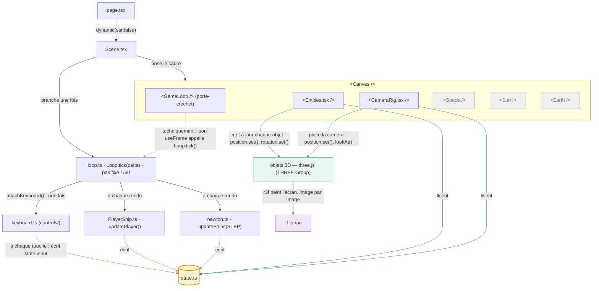

# ARCHITECTURE — Space Wars 3D

La carte du chantier : qui va où, et pourquoi. Les dossiers naissent quand leur contenu existe — jamais de dossier vide.

> **⚠️ DOCUMENT CONTRAIGNANT POUR TOUT AGENT DE CODAGE.**
> Ce fichier décrit l'architecture *actée* du projet. Chaque décision qui y figure (les principes, l'arbre, les règles de circulation, les contradictions tranchées) a été débattue et validée par Thierry — elle n'est **pas négociable, pas "améliorable", pas optionnelle**. Avant de créer un fichier ou un dossier, tu dois pouvoir répondre à : *"dans ce document, où est-ce que ça va ?"* Si la réponse n'y figure pas : **demande, ne devine pas** (charte, règle 4). Si un besoin te semble exiger de violer une règle ci-dessous : **arrête-toi et expose le conflit** (charte, règle 7). Ce document évolue par décision écrite ici d'abord, code ensuite.
 

---

## Sommaire

1. [Le fonctionnement en un schéma](#sec-01) — le cadre, ses blocs, le cœur et les miroirs — la décharge d’esprit, avant l’arbre.
2. [Les cinq grands principes](#sec-02) — la constitution du projet.
3. [L'arborescence cible](#sec-03) — qui va où, l'arbre complet annoté.
4. [Exemple concret](#sec-04) — un niveau JSON décortiqué.
5. [`Scene.tsx`](#sec-05) — le cadre et la troupe.
6. [`game/core`](#sec-06) — le cœur et le tour d'une frame.
7. [Qui rafraîchit l'écran ?](#sec-07) — le bouton et la machine, les deux boucles.
8. [`state.ts`](#sec-08) — où vivent les propriétés des objets, et comment le 3D les relit.
9. [`events.ts`](#sec-09) — le carrefour des événements (publier / s'abonner).
10. [`controls/`](#sec-10) — les entrées : capter, traduire, écrire.
11. [`game/physics/`](#sec-11) — les lois du monde : newton exécute, gravity fait subir, collisions arbitrent.
12. [`game/weapons/`](#sec-12) — les comportements d'armes : la coque porte, le comportement sert — le projectile, lui, est une entité.
13. [`game/capabilities/`](#sec-13) — les capacités (ex-ai/) : voir (cônes, raycast), esquiver, se battre — les rôles nommés assemblent.
14. [`levels/`](#sec-14) — le plateau : `data/` (les niveaux JSON), `roles/` (ex-brains/ : les rôles nommés), `index.ts` (le régisseur) — un niveau se décrit, il ne se code plus.
15. [`missions/`](#sec-15) — le déroulé : des scripts-oreilles au carrefour — déclencheurs → dialogues, spawns. Le niveau installe, la mission raconte.
16. [`types/`](#sec-16) — le dictionnaire : les contrats partagés — un barrel (`index.ts`), des fichiers par genre ; Zod aux portes, le jour de l'éditeur.
17. [Le fond du monde](#sec-17) — l'environnement en trois exemples.
18. [Où va quoi](#sec-18) — le tableau de correspondance.
19. [Règles de circulation](#sec-19) — les imports et leurs sens uniques.
20. [Les contradictions futures, déjà tranchées](#sec-20) — les débats clos d'avance.
21. [La démo Terre 2065](#sec-21) — son statut de référence visuelle.
22. [Ce qui n'existe pas encore](#sec-22) — et pourquoi c'est voulu.

---

<a id="sec-01"></a>

## Le fonctionnement en un schéma — la décharge d’esprit

Un schéma **Mermaid** avec les vrais noms du code, tel qu’il existe aujourd’hui — GitHub le dessine nativement, plus jamais de décalage de police. Convention : **fichiers en gras avec leur extension**, méthodes avec leurs parenthèses `updatePlayer()`, composants entre chevrons `<GameLoop />`. Les explications suivent le dessin.



Couleurs du schéma : **orange** = écrit dans `state.ts` (le cœur et le clavier) · **bleu** = lit la photo (les miroirs) · **vert** = recopie dans les objets 3D de three.js · **gris pointillé** = détail technique (le `useFrame()` de `<GameLoop />` porte l’appel) · **violet** = le rendu final : r3f peint les objets 3D à l’écran, image par image.

**À lire, dans l’ordre des flèches :**

1. **`page.tsx`** branche la scène (`ssr:false`) et n’existe plus. Une seule URL : `/play`.
2. **`Scene.tsx`** n’a AUCUNE méthode — deux gestes, deux flèches : à gauche il **pose le cadre** — `<Canvas />` et ses blocs ; à droite il **branche UNE FOIS** le cœur — `Loop.tick()` (techniquement : le `useFrame()` de `<GameLoop />` enregistre l’appel, et le premier `tick()` prépare le monde — `attachKeyboard()`, `spawnPlayer()`).
3. **`loop.ts`**, à CHAQUE rendu : l’accumulateur découpe le temps en **pas fixes** (`STEP = 1/60`), et à chaque pas il appelle deux composants : **`PlayerShip.ts`** → `updatePlayer()` (l’acteur décide — intentions dans la photo) puis **`newton.ts`** → `updateShips(STEP)` (le SEUL écrivain de position). **`collisions.ts`** et **`events.ts`** s’inséreront entre les deux le jour venu.
4. **`keyboard.ts`** (dans `controls/`) : branché **UNE fois** par le premier `tick()` — `attachKeyboard()`. Puis il ne vit que par ses événements : **à chaque touche** enfoncée/relâchée, il écrit directement `state.input` (`thrust`, `brake`, `yawLeft`… — des intentions 0-1, jamais des mouvements : le jeu ne voit jamais les touches).

5. **Les blocs du `<Canvas />`** : `<GameLoop />` (le porte-crochet), `<CameraRig.tsx />` et `<Entities.tsx />` (les miroirs), et le décor empilé `<Space />`, `<Sun />`, `<Earth />` (aucun `useFrame()` : il ne bouge pas).
6. **Qui écrit dans `state.ts` ? Le cœur et le clavier, personne d’autre** : `updatePlayer()`, `updateShips()` à chaque pas fixe, et `keyboard.ts` à chaque touche. Aucun bloc du `<Canvas />` n’y touche jamais.
7. **Les miroirs ont DEUX flèches, et c’est le point clé** : la première **lit** la photo (`state.ts`) ; la seconde **met à jour les objets 3D de three.js** — `<Entities.tsx />` fait `position.set()` / `rotation.set()` sur chaque `THREE.Group`, `<CameraRig.tsx />` place la caméra (`position.set()`, `lookAt()`). Lire sans recopier n’afficherait rien : la seconde flèche EST l’affichage.
8. **`state.ts`** (le hub) : écrit par le cœur et le clavier, lu par les miroirs, qui recopient vers les objets 3D. **Une seule direction de circulation.**

**La règle d’or : la scène pose le cadre et branche le cœur une fois ; à chaque rendu le cœur appelle ses composants et écrit la photo ; les miroirs la recopient en 3D ; `state.ts` est le seul pont.**

---

<a id="sec-02"></a>

## Les cinq grands principes

1. **`app/` reste minuscule** : une page Next.js ne fait que *brancher* (import d'une scène 3D en `ssr: false`). Zéro calcul dedans.
2. **UNE SEULE boucle de jeu** : les niveaux sont des *données* (JSON) que la boucle charge — jamais du code copié. La boucle est le théâtre, le niveau est la pièce. C'est ce qui rendra possible l'éditeur de niveaux (éditer un niveau = éditer un JSON).
3. **Modèle ≠ Entité** : la maquette 3D (visuel, réutilisable) vit dans une bibliothèque `models/` ; l'acteur logique (joueur, allié, ennemi) vit dans `game/entities/` et *référence* un modèle. La faction est une propriété de l'entité, pas un dossier. Changer de vaisseau, voler un chasseur ennemi : mêmes modèles, données différentes.
4. **Comportements (code) × Réglages (données)** : un missile, un ennemi, un mode de jeu = un petit nombre de comportements en TypeScript × une infinité de variantes en JSON. Le jour du multi, la logique pure de `game/` part sur le serveur, le client ne garde que le miroir — l'architecture est déjà taillée pour.
5. **Le rendu est un miroir** (`components/game/`) : les composants three.js ne *calculent* pas le jeu, ils *affichent* ce que `game/` décide. Interactive = possède un cerveau (module de comportement) ; inerte = simple décor. Un même objet peut changer de statut (épave inerte → amarrable) : on ajoute le cerveau, pas un dossier.

---

<a id="sec-03"></a>

## L'arborescence cible

```
src/
├── app/                          # POINT D'ENTRÉE — Next.js, une URL = un dossier
│   ├── layout.tsx                # coquille globale
│   ├── globals.css
│   ├── page.tsx                  # accueil : VITRINE qui branche MainMenu (le menu vit dans components/ui/menus/)
│   └── play/page.tsx             # LE jeu : VITRINE qui branche Scene (ssr: false) — une seule URL,
│                                 #   les niveaux sont des données, pas des pages
│
├── components/                   # LE MIROIR — tout ce qui s'affiche
│   ├── ui/                       # INTERFACE — React 2D pur, deux rôles
│   │   ├── menus/               # ÉCRANS (hors jeu, ils remplacent la scène)
│   │   │   ├── MainMenu.tsx     # accueil, sélection de mission
│   │   │   └── PauseMenu.tsx    # pause, options
│   │   └── hud/                 # SURIMPRESSIONS (dans le jeu, par-dessus la scène)
│   │       ├── Radar.tsx
│   │       ├── Reticle.tsx
│   │       ├── SpeedIndicator.tsx
│   │       └── OffscreenArrows.tsx  # flèches d'ennemis hors-champ
│   │
│   └── game/                     # RENDU 3D — composants three.js
│       ├── Scene.tsx             # LE CADRE ET LA TROUPE : le <Canvas> (le cadre WebGL), et
│                                 #   l'assemblage CameraRig + Environment + Entities + Effects
│                                 #   (la troupe). Aucun niveau, aucun mode dedans —
│                                 #   voir section « Scene.tsx » ci-dessous
│       ├── Entities.tsx          # LE MIROIR DES ENTITÉS : un composant par espèce vivante —
│                                 #   lit la photo (state) dans son useFrame de RENDU et monte
│                                 #   une maquette par fiche. Ne calcule rien, ne décide rien :
│                                 #   il RECOPIE (voir section « state.ts » ci-dessous)
│       ├── CameraRig.tsx         # LA CAMÉRA : lit la photo (position du vaisseau) et place la
│                                 #   caméra qui suit — un miroir de plus, rien d'autre
│       ├── models/              # BIBLIOTHÈQUE DE MAQUETTES (réutilisables, toute faction)
│       │   ├── ships/           # chasseurs, croiseurs, vaisseaux capitaux
│       │   │   ├── FalconMk2.tsx    # ex. : le chasseur du joueur au début
│       │   │   └── Interceptor.tsx  # ex. : le vaisseau emprunté à la mi-campagne
│       │   ├── weapons/         # missiles, roquettes, torpilles (maquettes)
│       │   │   ├── Rocket.tsx       # ex. : roquette ~40 cartouchées
│       │   │   └── Torpedo.tsx      # ex. : torpille anti-module
│       │   └── props/           # stations, astéroïdes, conteneurs, épaves
│       │       └── Container.tsx    # ex. : conteneur de fret (décor inerte)
│       ├── effects/             # explosions, traînées, débris (le visuel de la destruction)
│       └── environment/          # LE FOND DU MONDE — décor et éclairage (3 exemples)
│           ├── Earth.tsx         # la planète : sphère + textures + nuages animés (un fichier, une technique)
│           ├── Space/            # LE FOND SPATIAL — un répertoire, une porte, quatre couches
│           │   ├── index.tsx     # LE CHEF (toujours "index") : assemble les couches, lit le preset ("space": "deep")
│           │   ├── Void.tsx      # couche 1 : noir de base, dégradé, lueur zodiacale
│           │   ├── Stars.tsx     # couche 2 : le nuage de Points (les étoiles)
│           │   ├── MilkyWay.tsx # couche 3 : bande panoramique discrète
│           │   └── Exposure.tsx  # couche 4 : adaptation à la luminance — commande l'estompage des autres
│           └── Sun.tsx           # AUJOURD'HUI : UN fichier — le soleil paramétrable (presets distant / l1 / near)
│                                 #   UN JOUR : le répertoire Sun/ — index.tsx le chef, couches SunCore,
│                                 #   SunCorona, SunEruptions — si un preset exige un rendu propre.
│                                 #   Même les missions PROCHES du soleil (preset "near") ne changent RIEN
│                                 #   à l'organisation : même chef, même porte — seules les valeurs des
│                                 #   curseurs diffèrent (règle des curseurs).
│
├── game/                         # LOGIQUE PURE — TypeScript, zéro React, zéro three.js
│   ├── core/                     # LE CŒUR — les organes vitaux qui battent à chaque frame,
│   │                             #   quel que soit le niveau (de l'horloge : QUAND, pas QUOI)
│   │   ├── loop.ts               # le battement de cœur : cadence les update à PAS FIXE (dt identique
│   │                             #   sur toute machine) — une seule, pour toujours. L'ancien
│   │                             #   update(dt) du canvas = UN battement, appelé par elle
│   │   ├── state.ts              # la PHOTO du monde à l'instant T : qui vit, où, score, phase.
│   │                             #   Pas les acteurs (entities/) — leur état collectif
│   │   └── events.ts             # petit carrefour d'événements (mort, impact, trigger)
│   ├── entities/                 # LES ACTEURS (classes : comportement + attributs ; référencent
│   │                             #   un modèle 3D ; leurs VALEURS viennent du JSON du niveau)
│   │   ├── PlayerShip.ts         # le vaisseau piloté (peut changer de modèle en cours de partie)
│   │   ├── NpcShip.ts            # alliés ET ennemis — faction = propriété
│   │   ├── Projectile.ts         # missile/roquette/torpille : comportement + variantes
│   │   └── Prop.ts               # objets inertes du niveau (décor avec ou sans cerveau)
│   ├── controls/                 # entrées : capter (clavier, souris, plus tard gamepad/WebXR),
│   │                             #   traduire en ACTIONS, écrire le champ input de la photo
│   │   ├── keyboard.ts           # ex. : le clavier (touches → intentions)
│   │   └── mouse.ts              # ex. : la souris (visée, clic maintenu → intentions)
│   ├── physics/
│   │   ├── newton.ts             # L'INTÉGRATEUR : poussée, inertie, plafond, frein, boost, rotation inertielle amortie — LUI SEUL écrit position (mission 1 !)
│   │   ├── collisions.ts         # L'ARBITRE multi-espèces : grossier d'abord, dégâts + carrefour ensuite — jamais la mort
│   │   └── gravity.ts            # puits gravitationnels (plus tard) — FAIT SUBIR : courbe la vitesse, ne déplace jamais
│   ├── weapons/                  # COMPORTEMENTS d'armes : droite, guidé, verrouillé… (code) — PAS des
│                                 #   entités : pas de fiche dans la photo, jamais réveillées par la boucle ;
│                                 #   référencées par les fiches des vaisseaux (le projectile, lui, EST une entité)
│   │   ├── plasma-cannon.ts      # ex. : le tir droit (joueur ET ennemis — même arme)
│   │   └── homing-missile.ts     # ex. : le missile guidé (verrouille une cible)
│   ├── capabilities/             # CAPACITÉS (ex-ai/) : voir (cônes, raycast), esquiver, se
│                                 #   battre (as) — les RÔLES nommés vivent dans levels/roles/ ;
│                                 #   un cerveau ne connaît que la photo : il lit, écrit des
│                                 #   intentions, newton exécute (équité : l'IA ne triche pas)
│   │   ├── detect.ts             # ex. : voir — cônes, sphères radar, raycast
│   │   └── evade.ts              # ex. : esquiver — drifts, loopings (le cœur des as)
│   ├── levels/                   # LE PLATEAU : qui se trouve où au lever de rideau (état initial)
│   │   ├── index.ts              # chargeur : lit un JSON → instancie entités et décors
│   │   ├── data/                 # NIVEAUX = DONNÉES (JSON) : objets, positions, rôles
│   │   │   ├── earth-orbit-tutorial.json   # ex. : le tutoriel minier (acte 0)
│   │   │   └── station-defense.json       # ex. : défense de station de l'acte 3
│   │   └── roles/                # rôles nommés (ex-brains/) référencés par les JSON
│   │       ├── patrol-route.ts          # ex. : ronde de patrouille (waypoints)
│   │       └── turret-guard.ts          # ex. : tourelle de station (cible + portée)
│   └── missions/                 # LE DÉROULÉ : scripts-oreilles au carrefour — déclencheurs
│                                 #   → dialogues, spawns (le niveau installe, la mission raconte)
│       ├── act0/                        # les missions de l'acte 0 (scripts d'événements)
│       │   └── earth-orbit-tutorial.ts   # ex. : le tutoriel minier
│       └── act3/                        # les missions de l'acte 3
│           └── station-defense.ts        # ex. : la défense de station
│
└── types/                        # LE DICTIONNAIRE : les contrats TypeScript partagés —
    ├── index.ts                 # LE BARREL : la porte unique (importe tout, exporte tout)
    ├── sheets.ts                # ex. : les fiches (ShipSheet, NpcSheet, ProjectileSheet…)
    ├── intents.ts               # ex. : les intentions (InputIntent — thrust, yaw… des 0-1)
    └── events.ts                # ex. : les événements du carrefour (GameEvent)
                                 #   ; Zod aux portes le jour de l'éditeur (schémas ici,
                                 #   validation dans le chargeur)
```

---

<a id="sec-04"></a>

## Exemple concret — que contiendrait `levels/data/station-defense.json` ?

```json
{
  "id": "station-defense",
  "name": "Défense de la station Vega",

  "environment": {
    "earth": true,
    "space": "orbit",
    "sun": { "preset": "distant", "direction": [0.4, 0.2, -0.9] }
  },

  "player": { "model": "falcon-mk2", "position": [0, 0, 120], "weapons": ["plasma-cannon", "homing-missile"] },

  "npcs": [
    { "model": "falcon-mk2", "faction": "ally",
      "position": [30, 0, 100], "role": "wingman-follow", "callsign": "Vega-2" },

    { "model": "interceptor", "faction": "enemy",
      "position": [-200, 40, -300], "role": "patrol-route", "weapons": ["plasma-cannon"],
      "waypoints": [[-200, 40, -300], [0, 60, -500], [150, 0, -300]] },

    { "model": "interceptor", "faction": "enemy",
      "position": [220, -30, -400], "role": "patrol-route",
      "waypoints": [[220, -30, -400], [50, -60, -550], [-180, -20, -350]] }
  ],

  "props": [
    { "model": "station-vega", "position": [0, 0, -100] },
    { "model": "container", "position": [15, -8, -80], "role": "turret-guard" }
  ],

  "mission": { "script": "act3/station-defense.ts" }
}
```

À lire attentivement, tout s'y retrouve :
- **Le joueur et l'ennemi partagent la même arme** (`plasma-cannon`) — même comportement, mêmes dégâts, l'équité jusqu'aux canons ; le missile guidé du Falcon est un réglage de SA fiche, pas un code différent (section `weapons/`).
- **Le joueur ET l'allié portent le même modèle** (`falcon-mk2`) — la faction est une propriété, pas un dossier.
- **Les deux ennemis partagent le même modèle** (`interceptor`) et le même cerveau (`patrol-route`) avec des *rondes différentes* — code partagé, données différentes.
- **Le conteneur est inerte… sauf celui qui porte un cerveau** (`turret-guard`) — même JSON, même chargeur.
- **Un as serait le même JSON** avec un cerveau plus riche (ex. : `ace-duel` dans `levels/roles/`) et une fiche corsée — pas une espèce nouvelle : *chasseur = 1 coup, as = duel*.
- **Le décor** (`station-vega`, la Terre) est une maquette de plus — le monde entier n'est qu'une liste d'objets.
- **L'environnement lui aussi est des données** : preset du soleil, état du fond spatial (`"space": "orbit"`). Le jour de la mission du Soleil, ce même champ deviendra `"sun": { "preset": "near", "heatRadius": 25 }` — même chargeur, autre monde.
- **Le scénario** est un champ qui référence le script d'événements dans `missions/act3/`.
- Et pour jouer le tutoriel minier à la place : on charge `earth-orbit-tutorial.json`. **Même boucle, autres données.**

---

<a id="sec-05"></a>

## `Scene.tsx` — le cadre et la troupe

Le `<Canvas>` (fourni par react-three/fiber) est **LE CADRE** : une zone WebGL dans la page — un rectangle avec un moteur de rendu, une caméra, le branchement de la boucle d'affichage. Seul, il affiche un écran noir vide. `Scene.tsx` fait la seconde moitié du travail : **placer dans le cadre le décor, les acteurs et les effets** — sans connaître aucun niveau ni mode :

```tsx
function Scene() {
  return (
    <Canvas>              // LE CADRE (r3f)
      <CameraRig />       // ┐
      <Environment />     // │ la troupe :
      <Entities />        // │ tout ce qui se joue
      <Effects />         // ┘ dans le cadre
    </Canvas>
  );
}
```

- `Environment` lit le preset du niveau (Terre ? soleil `near` ? `"space": "deep"` ?) — jamais codé en dur.
- `Entities` est le pur miroir : il lit l'état du monde (`game/`) et monte une maquette par entité — le jour du mode course ou du brevet, ce sont l'état et les scripts qui changent, pas cette ligne.
- Le HUD vit HORS du cadre, dessiné par-dessus en HTML (`components/ui/hud/`) : le radar n'est jamais dans la scène 3D.

---

<a id="sec-06"></a>

## `game/core` — le cœur, et le tour d'une frame

- **`loop.ts` = l'horloge** (QUAND) : elle bat à pas fixe — le même `dt` sur toute machine, même quand le navigateur cale. Ce qu'elle appelle à chaque battement, c'est l'ancien `update(dt)` du canvas, découpé en organes (newton, collisions, IA).
- **`entities/` = les personnes** (classes, savoir-faire : voler, patrouiller) ; **`state.ts` = la photo de la scène à l'instant T** (qui vit, où, score, phase). Le cœur fait agir les acteurs, les acteurs modifient la photo, le miroir reflète la photo — jamais les acteurs directement.

```
loop (le cœur bat, pas fixe)
  → les acteurs décident (intentions)          — thrust, yaw… des valeurs 0-1 dans la photo
  → la physique exécute                        — gravity fait subir, newton fait avancer (section physics/)
  → collisions arbitrent (dégâts, annonces au carrefour)
  → le Canvas redessine tout, à chaque frame    — le miroir montre ce qui existe MAINTENANT
```

⚠️ La photo n'est jamais "prise" ni "appelée" : `state` est un tableau d'affichage vivant que les acteurs modifient en agissant. Et le dessin n'est lancé par personne de notre code — voir la section suivante.

- **`PlayerShip`** : classe TypeScript — attributs (coque, bouclier, vitesse max, maniabilité) et méthodes (`fire()`, `applyThrust()`, `turn()` — qui écrivent des INTENTIONS dans la photo ; les lois de `physics/` font le reste). Trois nuances : ses *valeurs* viennent du JSON du niveau (la classe ne porte que le comportement) ; ses armes montées sont des *références* vers `weapons/` ; c'est `controls/` qui lit le clavier et l'appelle — elle ne sait pas qu'un clavier existe (gamepad et VR passeront par là sans la toucher).

---

<a id="sec-07"></a>

## Qui rafraîchit l'écran ? — le bouton et la machine

Personne dans notre code n'écrit jamais "affiche maintenant". Le rafraîchissement est une chaîne à trois étages :

1. **Le navigateur** — l'écran se repeint à son rythme propre (souvent ~60 fois/seconde, mais 120-144 sur un écran à haut rafraîchissement — rAF suit l'écran, quel que soit son rythme) ; il fournit `requestAnimationFrame` : *"donne-moi une fonction, je l'appellerai à chaque rafraîchissement"*. La prise électrique de tout jeu web.
2. **La boucle de RENDU du `<Canvas>` (r3f) — invisible, dans `node_modules`.** Le `<Canvas>` écrit dans `Scene.tsx` est **le bouton** : trois lignes qui installent un objet, à l'endroit de notre choix — comme poser un interrupteur. La **machine** qu'il installe (moteur three.js, caméra, boucle branchée sur `requestAnimationFrame`) vit dans la bibliothèque : à chaque frame, elle appelle tous les `useFrame` puis **redessine TOUT, mécaniquement, pour toujours**. On ne possédera jamais cette boucle — on possède l'endroit où le cadre s'installe et la troupe qu'on y monte.
3. **Notre boucle de JEU (`loop.ts`)** — le cœur à pas fixe, branché dans la première par le seul point de contact :

```tsx
// Le crochet unique entre notre monde et la machine r3f
function GameLoop() {
  useFrame(() => { loop.tick(); });  // appelé à CHAQUE frame par la boucle du Canvas
  return null;                       // ce composant n'affiche rien — il est branché
}
```

**Deux boucles, pas une** : le rendu (rythme de l'écran, automatique, à la bibliothèque) et le jeu (pas fixe, à nous) — la seconde s'exécute à l'intérieur de la première. Parfois la boucle de jeu jouera deux battements entre deux images, parfois aucun : peu importe, la physique ne dépend jamais du hasard des machines.

**Un seul useFrame qui touche au monde, autant que nécessaire qui l'affichent.** `GameLoop` est l'unique crochet du côté JEU. Les miroirs (`Entities.tsx`, `CameraRig.tsx`…) ont leurs **propres** `useFrame` de rendu — légitimes, puisque le miroir est du React : ils ne font que lire la photo et recopier vers three.js. Test infaillible : *coupe le composant ; si le jeu continue de vivre, c'est un miroir.* Et **l'ordre dans `Scene.tsx` compte** : r3f appelle les `useFrame` dans l'ordre de montage — `GameLoop` se monte **en premier**, les miroirs ensuite : le monde avance d'abord, on le photographie ensuite (l'image affichée est toujours celle de CETTE frame).

Conséquence : *"le miroir relit la photo"* n'est pas un événement que quelqu'un lance — comme tout est redessiné à chaque frame, l'affichage est **toujours** l'image de la photo à l'instant présent. La relecture n'est pas une action, c'est une conséquence.

| Qui | Quoi | Où ça vit |
|---|---|---|
| Navigateur | propose le rythme (`requestAnimationFrame`) | le moteur du navigateur |
| `<Canvas>` (r3f) | la boucle de *rendu* : `useFrame` + redessiner | `node_modules` — invisible |
| `loop.tick()` | la boucle de *jeu* à pas fixe : faire agir les acteurs | **notre code**, branché via `useFrame` |

---

<a id="sec-08"></a>

## `state.ts` — où vivent les propriétés, et comment le 3D les relit

**Règle : la photo détient les données, l'acteur détient le comportement.** Un objet, deux moitiés — dans des fichiers séparés, délibérément.

- **L'acteur** (`entities/`) est le comportement : ses méthodes écrivent dans la photo. Il sait où est son état : dans `state.ts`.
- **La photo** (`state.ts`) est l'état de TOUS les objets à l'instant T : positions, vitesses, angles, score, phase — la **source de vérité unique**.
- **Les propriétés d'un objet se trouvent donc à UN seul endroit : `state.ts`.** Jamais dans l'entité, jamais dans un composant.

Pourquoi couper l'objet en deux ? (choix délibéré, pas un accident)

1. **Sauvegarder le monde tient en une ligne** : `JSON.stringify(state)` — sauvegarde complète, replay, futur multi.
2. **Le miroir a UN endroit à lire** — il ne connaît ni les acteurs, ni leurs méthodes.
3. **Le cœur reste pur** : loop, state, acteurs = du TypeScript simple, zéro Three.js, zéro React.

Les contrats : **une interface par espèce** (dans `types/`), importée par l'acteur comme par le miroir — c'est le pont entre les deux moitiés. Une interface ne détient ni données ni code : elle garantit que la photo de cette espèce a toujours cette forme-là ; ajouter un champ au contrat, et TypeScript signale partout où il faut s'adapter.

```
// state.ts — la photo : des listes par espèce, rien d'autre. Aucune méthode.
ships: [] as Ship[],
asteroids: [] as Asteroid[],
planets: [] as Planet[]
```

**Quatre disciplines qui vont avec :**

1. **La photo ne fait rien** : aucun helper, aucune méthode dedans. Faire naître un objet = `spawn()` dans SON entité, qui pousse la fiche dans SA liste.
2. **Chaque espèce ne touche que sa propre liste** : `NpcShip` écrit dans `npcs`, jamais dans `projectiles`. L'exception assumée : les systèmes multi-espèces (collisions) — des *systèmes*, pas des acteurs.
3. **Un miroir par espèce, pas par objet** : `Entities` lit les listes de la photo et monte une maquette par fiche — 500 astéroïdes = une liste, un miroir.
4. **Pas de fiche, pas de miroir** : un décor immobile n'a pas de propriétés vivantes — il est dessiné une fois, point.

Exemple — la naissance, le vol et l'affichage d'un ennemi :

```ts
// types/ — le contrat de l'espèce NpcShip : la forme de sa fiche. Le pont entre les deux moitiés.
export interface NpcSheet {
  position: Vec3;
  velocity: Vec3;
  hp: number;
  alive: boolean;
}

// state.ts — la photo : SA liste, typée par le contrat. Rien d'autre.
npcs: [] as NpcSheet[],

// entities/NpcShip.ts — L'ACTEUR : spawn dans son fichier, écrit dans SA liste à chaque update.
export function spawnNpc(position: Vec3) {
  state.npcs.push({ position, velocity: { x: 0, y: 0, z: -2 }, hp: 3, alive: true });
}

export function updateNpcs(dt: number) {
  for (const npc of state.npcs) {
    if (!npc.alive) continue;
    npc.position.x += npc.velocity.x * dt;  // l'acteur ÉCRIT la photo — c'est tout son métier
    npc.position.z += npc.velocity.z * dt;
  }
}

// components/game/Entities.tsx — LE MIROIR : il ne calcule rien, il RECOPIE la photo.
useFrame(() => {
  for (const npc of state.npcs) {
    const mesh = meshes.get(npc);            // une maquette par fiche
    mesh.position.set(npc.position.x, npc.position.y, npc.position.z);
  }
});
```

À lire : l'ennemi naît (`spawnNpc`), vit (`updateNpcs` écrit la photo), s'affiche (le miroir recopie) — **et les trois fichiers ne se connaissent que par le contrat et la photo**. Tuer l'ennemi plus tard : `npc.alive = false` dans la photo, le miroir masque la maquette, et le carrefour (section suivante) annonce la mort à qui veut l'entendre.

**Comment le 3D les relit ? (le miroir)** — `Entities` (le miroir) fait exactement une chose à chaque frame, dans son `useFrame` : **recopier** — lire la photo, coller les valeurs dans les objets three.js. Il ne calcule rien, ne décide rien. Comme tout est redessiné à chaque frame, l'affichage est toujours l'image de la photo à l'instant présent (voir « Qui rafraîchit l'écran ? »).

⚠️ **Dans un miroir, aucune écriture dans la photo** — que des lectures et des `.set()` sur les objets three.js. Un `+=`, un `if (hp <= 0)` de gameplay dans un `useFrame` de miroir = bug d'architecture : retourne dans `game/`.

La chaîne, toujours la même phrase :

> Le loop réveille les acteurs ; les acteurs écrivent dans la photo ; le miroir recopie ; r3f peint.

---

<a id="sec-09"></a>

## `game/core/events.ts` — le carrefour des événements

**Le problème qu'il résout.** Quand un événement important arrive dans le monde — un vaisseau meurt, un missile touche, le joueur entre dans une zone — plusieurs modules veulent réagir : le score, les effets visuels, le script de mission. Sans carrefour, l'annonceur devrait tous les connaître et les appeler un par un ; chaque module nouveau obligerait à retoucher le code de l'annonceur. Le carrefour inverse le lien : **celui qui annonce ne connaît pas ceux qui écoutent.** C'est le principe de l'EventDispatcher de Symfony : publier / s'abonner.

```ts
// events.ts — publier / s'abonner : l'annonceur ne connaît jamais les oreilles.
export type GameEvent =
  | { type: "enemy:death"; position: Vec3; points: number }
  | { type: "player:hit"; damage: number }
  | { type: "trigger"; zone: string };

const listeners: ((e: GameEvent) => void)[] = [];

export function on(fn: (e: GameEvent) => void) { listeners.push(fn); }   // s'abonner
export function emit(e: GameEvent) { for (const fn of listeners) fn(e); } // publier
```

Exemple — la mort d'un ennemi :

```ts
// NpcShip.ts — L'ANNONCEUR : il écrit la photo d'abord, puis publie. C'est tout.
if (this.hp <= 0) {
  this.alive = false;   // la photo d'abord (la vérité du monde)
  emit({ type: "enemy:death", position: this.position, points: 100 });
}

// Trois OREILLES, chacune dans SON fichier, aucune ne connaît NpcShip :
on(e => { if (e.type === "enemy:death") state.score += e.points; });            // le score
on(e => { if (e.type === "enemy:death") spawnExplosion(e.position); });         // les effets
on(e => { if (e.type === "enemy:death") mission.complete("destroy-patrol"); }); // le script de mission
```

**Règles du carrefour :**

1. **`on()` s'écrit une fois** — au montage du jeu, jamais par objet ni par ennemi. `emit` est appelé autant de fois qu'il y a d'événements : 3 oreilles abonnées, 50 morts = 150 exécutions d'oreilles, sans une ligne de plus à écrire.
2. **L'annonceur écrit la photo d'abord, publie ensuite.** L'événement transporte l'information minimale (position, points) — jamais l'objet entier.
3. **Les événements du monde ne sont pas les touches du clavier** : les entrées du joueur vivent dans `controls/` (section suivante). `events.ts` distribue ce que le MONDE annonce : mort, impact, trigger.
4. **Les scripts de mission (`game/missions/`) sont de grosses oreilles** : leurs déclencheurs ("quand la patrouille est détruite…") s'abonnent au carrefour — c'est la "machine à événements" annoncée dans l'arbre. Ajouter un module qui réagit (audio, succès, replays) = une oreille de plus dans SON fichier, l'annonceur ne bouge pas d'une ligne.

---

<a id="sec-10"></a>

## `game/controls/` — les entrées : capter, traduire, écrire

Le métier de `controls/` tient en trois verbes : **capter** (le clavier, la souris, plus tard le gamepad et la VR), **traduire** (des périphériques en *actions* : `thrust`, `fire` — jamais "flèche du haut"), **écrire** (l'état des actions dans la photo, champ `input`).

```ts
// controls/index.ts — tous les périphériques parlent "actions",
// le jeu ne voit jamais le matériel.
import { state } from "../core/state";

export function attachControls() {          // appelé UNE seule fois, au montage
  window.addEventListener("keydown", (e) => {
    if (e.code === "ArrowUp" || e.code === "KeyW") state.input.thrust = true;
    if (e.code === "Space") state.input.fire = true;
  });
  window.addEventListener("keyup", (e) => {
    if (e.code === "ArrowUp" || e.code === "KeyW") state.input.thrust = false;
    if (e.code === "Space") state.input.fire = false;
  });
  // plus tard : gamepad, WebXR — mêmes actions, même champ input.
}
```

Et la contrepartie dans la photo :

```ts
// state.ts — le champ input : des ACTIONS, pas des boutons.
input: { thrust: false, fire: false }
```

**Trois règles des entrées :**

1. **Sens unique** : `controls/` est le SEUL écrivain du champ `input` ; les acteurs (`PlayerShip`) ne font que le lire à leur tour de réveil. `PlayerShip` ne sait pas qu'un clavier existe — gamepad et VR passeront par `controls/` sans la toucher.
2. **Personne n'appelle `controls/` dans la boucle** : c'est le navigateur qui appelle les listeners au moment où la touche est pressée — n'importe quand, y compris entre deux battements. La photo sert d'intermédiaire : le monde lit les commandes aux pas fixes, à un moment où il est stable.
3. **Un périphérique de plus = un fichier ici, rien ailleurs.** La traduction vit tout entière dans `controls/` — déjà acté pour la VR : *"`controls/` gagne une entrée WebXR ; le reste ne sait même pas que ça existe"*.

---


<a id="sec-11"></a>

## `game/physics/` — les lois du monde : newton, collisions, gravity

**Un seul organe déplace, les autres font subir.** La physique est une chaîne d'étages, chacun avec son verbe — et UN SEUL a le droit d'écrire `position` :

| Organe | Verbe | Il écrit quoi ? |
|---|---|---|
| les acteurs (`entities/`) | **décider** | les intentions (`thrust`, `yaw`… — des valeurs 0-1, pas des mouvements) |
| `gravity.ts` | **faire subir** | la **vitesse** (il la courbe, il ne déplace JAMAIS) |
| `newton.ts` | **faire avancer** | la **position** (l'unique intégrateur du monde) |
| `collisions.ts` | **arbitrer** | les `hp` (jamais la position) |

Le tour d'un battement, complet :

```
loop (le cœur bat, pas fixe)
  → les acteurs décident      — intentions dans la photo (joueur via controls/, IA via ses cerveaux)
  → gravity fait subir        — ajoute des forces à la VITESSE, ne déplace pas
  → newton fait avancer      — position += velocity × dt : LE seul déplacement du monde
  → collisions arbitrent     — qui touche qui, maintenant que tout a bougé
  → le miroir recopie, r3f peint
```

L'ordre entre acteurs et gravity importe peu (additionner 2 + 3 ou 3 + 2, même total) — mais newton reste TOUJOURS le dernier avant collisions : on n'arbrite les contacts qu'une fois le mouvement terminé. **Gravity propose, newton dispose.**

**Pourquoi ce mur entre décider et exécuter ?** Équité : joueur, allié, ennemi, épave — la même loi s'applique à tous, un ennemi ne peut pas tricher la physique. Un seul endroit pour régler le monde : changer newton change le comportement de tous les acteurs sans toucher une ligne de leur code. Et le jour du multi, les lois partent sur le serveur telles quelles — les intentions voyagent, la découpe est déjà la bonne.

### `newton.ts` — l'intégrateur : poussée, inertie, plafond, frein, boost, rotation

- **La poussée lit des intentions, pas un clavier** : `input.thrust` est une valeur de la photo — newton ne sait pas qu'un clavier existe (gamepad et VR ne le toucheront pas).
- **L'inertie** : dans l'espace, rien ne freine — chaque battement applique `position += velocity × dt`, poussée ou pas. *Je relâche, je glisse pour toujours.* C'est ce qui fait du vol spatial un vol spatial, et non une voiture.
- **Le plafond de vitesse** : sans lui, on finit à 40 000 km/h et le jeu devient injouable. On mesure la longueur du vecteur vitesse, on la rabat sur le plafond **en gardant la direction** — on ne punit pas le pilote en le déviant. `maxSpeed` est un réglage de la fiche (JSON) : le Falcon file, le cargo rampe — comportement en code, réglages en données.
- **Les 6 degrés de liberté** : 3 axes de translation (poussée avant/arrière, dérive, montée) — le même plié répété trois fois ; 3 axes de rotation (tangage, lacet, roulis). Les intentions deviennent vitesse, la vitesse devient position.
- **Le frein** : dans l'espace, freiner n'est pas lever le pied (pas de sol pour te freiner) — c'est une rétrofusée : `input.brake` décroît la vitesse axe par axe.
- **Le boost** : PAS une nouvelle physique — les mêmes lignes avec d'autres réglages (`thrustPower × boostFactor`, plafond relevé). Les facteurs vivent dans le JSON : un vaisseau de course au boost monstrueux, un bombardier au boost ridicule — mêmes comportements, réglages différents. (Une jauge de boost avec carburant ? Discussion pour plus tard — si oui, un champ de plus dans la photo que newton décrémente.)
- **La rotation est inertielle AUSSI, puis amortie** (décision du 9 nov.) : la photo porte une vitesse angulaire, la commande de tangage/lacet/roulis est un COUPLE qui l'augmente ; et des stabilisateurs freinent la rotation en continu (`angularVelocity *= angularDamping`). Un seul facteur règle tout le ressenti :

| `angularDamping` | Comportement |
|---|---|
| `1.0` | jamais freiné — pirouettes infinies (simulateur pur, difficile) |
| `~0.90` | je relâche, le vaisseau s'arrête de tourner en ~1 s — le ressenti classique des jeux spatiaux |
| `0.5` | quasi instantané — arcade total |

  Le degré d'amortissement est un curseur PAR VAISSEAU dans le JSON : un chasseur vif amortit vite, un vaisseau capital tourne lourd et glisse longtemps sur sa rotation.

```ts
// newton.ts — les intentions deviennent mouvement. LUI SEUL écrit position.
for (const ship of state.ships) {
  const power = input.boost ? ship.thrustPower * ship.boostFactor : ship.thrustPower;
  if (input.thrust) ship.velocity.z += power * dt;                // poussée (intention 0-1)
  if (input.brake)  ship.velocity.z -= ship.brakePower * dt;      // rétrofusée
  ship.angularVelocity.y += input.yaw * ship.rotationPower * dt;  // la commande = un couple
  ship.angularVelocity *= ship.angularDamping;                    // les stabilisateurs
  ship.rotation.y += ship.angularVelocity.y * dt;                 // rotation inertielle
  ship.position += ship.velocity * dt;                            // LE déplacement — le seul du monde
}
```

### `collisions.ts` — l'arbitre : détecter, répondre

- **Un système, pas un acteur** — l'exception assumée de la discipline state n° 2 : le seul organe autorisé à lire PLUSIEURS listes (vaisseaux × projectiles × astéroïdes). Un arbitre, pas un joueur.
- **Le grossier d'abord, le précis ensuite** : 50 vaisseaux × 200 projectiles = 10 000 tests par battement. Le test sphérique est quasi gratuit (trois soustractions, `distSq` — pas de racine carrée) ; le test de forme précise ne se paie QUE quand les sphères se chevauchent. Le filtre pas cher pour tout le monde, le coûteux pour les rares élus.
- **La réponse** : la photo D'ABORD (`hp -= damage`), l'annonce ENSUITE (`emit({ type: "impact", ... })` au carrefour).
- **L'arbitre ne décide d'aucune mort** : collisions écrit les `hp`, point. C'est l'ACTEUR qui, à son tour de réveil, lit `hp <= 0`, gère sa disparition et publie `enemy:death` (voir `events.ts`). L'arbitre siffle, le joueur concerné se tord lui-même.
- **Le bouclier Whipple** : trois lignes de code, une variante de données. `"whipple": true` dans le JSON de la fiche = une fine couche externe sacrifie le projectile avant la coque ; la torpille anti-module le traverse (`"penetrating": true`). Comportements en code, variantes en données — jusqu'aux impacts.

### `gravity.ts` — faire subir, jamais déplacer (plus tard)

La pomme de Newton en grand : les masses du monde (la Terre, le Soleil) attirent tout ce qui vole. Trois usages, UN mécanisme (une zone de danger qui agit sur la vitesse) :

1. **L'orbite** — tomber sans arrêt vers la Terre + aller assez vite de côté = ne jamais atteindre le sol. La géographie naturelle des missions en orbite.
2. **Le soleil proche** — même mécanisme que `heatRadius` : s'approcher trop, c'est être entraîné et puni (déjà acté dans les contradictions).
3. **L'atmosphère terrestre** — friction si trop bas : réutilise le même plié.

Pourquoi "plus tard" : aucune mission n'en a besoin avant d'avoir des choses AUTOUR desquelles tomber. Le jour venu : une quinzaine de lignes, il s'insère à l'étage "faire subir" — newton ne saura même pas qu'il existe. D'autres "faire subir" s'y rangeraient pareil (traînée atmosphérique, rayon tracteur, onde de choc).

---


<a id="sec-12"></a>

## `game/weapons/` — les comportements d'armes : la coque porte, le comportement sert

`weapons/` est le tiroir des **comportements d'armes** : droite, guidée, verrouillée, torpille lente… (code). Une arme n'est **PAS** une entité — et comprendre pourquoi éclaire toute la frontière du projet.

**Le test d'entrée d'`entities/` : la fiche dans la photo, JAMAIS le modèle 3D.** *"Est-ce que ça naît, vit et peut mourir dans la photo ?"*

| | Une entité (`NpcShip`) | Une arme (`plasma-cannon`) | Le projectile |
|---|---|---|---|
| a une fiche dans `state.ts` ? | ✔️ vit, bouge, meurt | ✖️ n'existe pas dans la photo | ✔️ naît, vole, peut mourir |
| réveillée par la boucle ? | ✔️ chaque battement | ✖️ jamais — elle *sert*, quand on l'appelle | ✔️ comme toute entité |
| cycle de vie ? | naît, agit, meurt | aucun — elle dort dans le catalogue | naît du tir, meurt à l'impact |
| verdict | entité | **comportement** (`weapons/`) | **entité** (avec son modèle) |

⚠️ **Le faux critère à ne jamais utiliser : "avoir un modèle 3D".** Un décor immobile *a* un modèle et n'est PAS une entité (pas de fiche, dessiné une fois). Un projectile est une entité avec fiche ET modèle. Une arme n'a ni fiche ni modèle à elle : ses canons *dessinés* appartiennent à la maquette du vaisseau, son effet *visible* à la maquette du projectile. **Le modèle est le costume d'une fiche, jamais sa carte d'identité.** Et le modèle ne "contient" pas l'arme au sens logique : changer la coque du Falcon pour un modèle neuf sans canons dessinés ne lui enlève pas son `plasma-cannon` — tant que sa fiche le référence. Le modèle est l'apparence, le comportement est ailleurs.

**"Pourquoi pas dans `entities/` ?" — la question légitime, et sa réponse honnête.** Techniquement, RIEN ne l'empêche : TypeScript s'en fiche, la greffe marcherait pareil depuis un sous-dossier d'`entities/`. C'est une **discipline de métier** : `entities/` a un serment — *ici vivent les choses qui ont une fiche dans la photo* — et une arme n'a pas de fiche. Les armes sont le **troisième tiroir du même meuble** : la coque vit dans `entities/`, et autour d'elle les capacités qu'on lui visse — maquette (`models/`), rôle (`levels/roles/`), canon (`weapons/`). Aucune n'est une chose vivante ; toutes sont *montables*. Mélanger canon et coque dans le même dossier, et c'est la pente du fourre-tout : la question *"dans ce document, où est-ce que ça va ?"* perdrait sa réponse unique.

Les trois mauvaises réponses, pour mémoire :

1. **le code du tir dans `PlayerShip` seulement** → l'ennemi ne sait pas tirer ;
2. **dupliqué dans `PlayerShip`, `NpcShip`, `Turret`** → régler la cadence = la régler trois fois… et oublier la quatrième ;
3. **une classe mère `Ship.fire()`** → l'héritage piège : un cargo sans armes hériterait quand même d'un `fire()`.

**Symétrie exacte avec les cerveaux** — le même mécanisme, déjà acté :

| | Ça décide de… | Vit dans | Référencé par |
|---|---|---|---|
| `roles/patrol-route.ts` | *où aller* | `levels/roles/` | le JSON du niveau |
| `weapons/plasma-cannon.ts` | *comment tirer* | `weapons/` | la fiche du vaisseau |

Un `NpcShip` sans cerveau dérive ; avec `patrol-route` il patrouille ; avec `turret-guard` il garde. Idem côté armes — et le libre-échange se lit dans les données :

```json
// la fiche du Falcon Mk2 — deux armes montées, des références
{ "model": "falcon-mk2", "weapons": ["plasma-cannon", "homing-missile"] }

// un chasseur de patrouille — MÊME comportement "plasma-cannon", réglages différents
{ "model": "interceptor", "weapons": ["plasma-cannon"] }
```

```ts
// PlayerShip.fire() — son métier rapetisse jusqu'à : "arme, à toi"
fire() { for (const id of this.weapons) weaponsRegistry[id].trigger(this); }

// weapons/plasma-cannon.ts — le comportement : "voilà comment on tire"
export const plasmaCannon = {
  trigger(ship: Ship) {
    if (ship.cooldown > 0) return;
    spawnProjectile({ from: ship, speed: 400, damage: 5 });  // une NOUVELLE fiche naît dans la photo
    ship.cooldown = 0.25;                                     // cadence : réglage de la fiche, pas du comportement
  }
};
```

À lire : `fire()` ne sait pas tirer — il **délègue** au comportement monté ; le comportement ne sait pas voler — il **fait naître un projectile**, qui est une entité à part entière (fiche, vitesse initiale, dégâts, modèle) et retombe dans la chaîne de `physics/` : newton le déplace, collisions l'arbitrent (`impact`), le carrefour l'annonce. Le tir n'échappe à aucune règle du monde.

**Équité jusqu'aux canons.** Le même `plasma-cannon` sert le joueur et l'ennemi : même projectile, mêmes dégâts — l'équité de newton continue jusqu'aux armes. La tourelle de station ? Une espèce différente (`Turret` — fiche, hp, elle meurt) qui référence la **même** arme : zéro ligne dupliquée.

**Le cas limite qui confirme la règle.** Un canon peut-il devenir vivant ? Oui — et ce jour-là, il *change de statut* : une tourelle avec des hp, qui vise seule et peut mourir, devient une **entité** (fiche, dossier d'espèce) et **référence une arme** pour tirer. La même chose peut être comportement (canon monté sur coque) ou entité (tourelle qui meurt), selon qu'elle a une fiche ou non — et le dossier la place selon la réponse à cette seule question.

En une phrase : **une entité est une coque qui porte des comportements — cerveaux pour agir, armes pour tirer — et les comportements dorment dans leurs tiroirs, montables sur n'importe quelle coque.**

---


<a id="sec-13"></a>

## `game/capabilities/` — les capacités : voir, esquiver, se battre

`capabilities/` (ex-`ai/`) est la bibliothèque des **sens et des réflexes** : détection (cônes, raycast), esquives, as. C'est le jumeau de `weapons/` — des comportements montables — simplement montés entre cerveaux cette fois.

**Capacités vs rôles — la frontière avec `levels/roles/` :**

| | `levels/roles/` | `game/capabilities/` |
|---|---|---|
| contient | des rôles **nommés** : `patrol-route`, `turret-guard` | des **capacités** : voir, esquiver, piloter un duel |
| c'est | un *rôle* ("ronde de patrouille") | un *savoir-faire* ("détecter une cible dans un cône") |
| référencé par | le JSON du niveau | les rôles nommés |

Autrement dit : `patrol-route` dit *où aller* ; `capabilities/` lui fournit *comment voir, comment fuir, comment se battre*. Un rôle nommé **assemble** des capacités — la même architecture de montage que coque → canon → cerveau.

**1. La détection — trois couches, du grossier au précis** (le même plié que collisions) :

- **Le cône de vision** — chaque ennemi regarde devant lui dans un cône (angle + portée). Le test est le produit scalaire : *"l'angle entre mon regard et la direction vers toi est-il plus petit que mon angle de vision ? à portée ?"* Prototype acté (chantier n°2) : **les cônes visualisés dans la scène, qui rougissent quand le joueur est repéré**.
- **La sphère radar** — à bout portant, plus besoin de cône : il te *sent* autour de lui (le test sphérique pas cher).
- **Le raycast** — le test précis, le coûteux, payé en dernier : *"même dans mon cône, un morceau de station fait-il écran entre toi et moi ?"* La ligne de vue contre le décor — d'où les **courses-poursuites dans les flottes** : casser la ligne de vue en traversant la masse, *le système de détection retourné en défense*.
- **Et la perf** : des ennemis **endormis** au-delà d'un tick radius (~60 unités, déjà acté) — trop loin pour te voir, le cerveau dort et ne coûte rien. Le grossier d'abord, jusqu'aux cerveaux.

**2. Les esquives — la difficulté du jeu.** La doctrine de létalité est tranchée : pas de boucliers-éponges, 1-3 coups, avions WWII — **le défi vient de l'IA évasive** (drifts, loopings, breaks), pas des points de vie. Et la beauté de la plomberie : une esquive n'est qu'une **intention** écrite dans la photo (*"poussée 80 %, lacet fort gauche"*) — c'est **newton qui l'exécute**. L'ennemi ne triche pas la physique : ses drifts glissent comme les tiens. **L'équité jusqu'aux cerveaux.**

**3. Les as — des réglages, pas une espèce.** Un as (ennemi d'élite, nommé, mini-boss) n'est pas une classe nouvelle : un `NpcShip` ordinaire avec un cerveau plus riche et une fiche aux réglages corsés. La grille est déjà tranchée : *chasseur = 1 coup, as = duel*. Le même comportement en code, des réglages différents — la doctrine jusque dans l'élitisme.

**La place dans la chaîne** — un cerveau ne fait que deux choses, à son tour de réveil :

```
le cerveau LIT la photo (où est le joueur ? dans mon cône ?)
           ÉCRIT des intentions (poussée, lacet, tir)
→ newton exécute → collisions arbitrent → le miroir recopie, r3f peint
```

Un cerveau ne touche ni three.js, ni le clavier — il ne connaît que la photo. C'est pourquoi **Mistral, la coéquipière IA du joueur, pilotera avec exactement les mêmes organes** : ennemis et alliée, même bibliothèque de sens et de réflexes — la fiction et le moteur seront d'accord.

En une phrase : **un `NpcShip` sans cerveau dérive ; avec `patrol-route` il patrouille ; muni des capacités de `capabilities/` il voit, fuit et se bat — la coque porte, le cerveau décide, la loi exécute.**

---


<a id="sec-14"></a>

## `levels/` — le plateau : `data/`, `roles/`, `index.ts`

La récompense de toute l'architecture : ici, un niveau ne se code plus, il **se décrit**. La doctrine (principe n°2) : UNE boucle, et des niveaux = des données JSON. Ajouter le niveau 42 n'ajoute JAMAIS une ligne de code — seulement un fichier. Trois tiroirs, un métier chacun :

| Tiroir | Contient | Métier |
|---|---|---|
| `index.ts` | du code | **LE RÉGISSEUR** : lit un JSON → fait naître les fiches dans la photo |
| `data/` | des fichiers JSON | **LES NIVEAUX** : qui, où, avec quoi — l'état au lever de rideau |
| `roles/` | du code (ex-`brains/`, renommé le 9 nov.) | **les RÔLES nommés** de mise en scène, référencés par les JSON |

**`index.ts` — le régisseur.** L'inverse exact du miroir : le miroir lit la photo pour afficher ; le chargeur lit des DONNÉES pour **peupler** la photo.

```ts
// levels/index.ts — dans les grandes lignes
export function loadLevel(name: string) {
  const level = parse(jsonDe(`levels/data/${name}.json`));   // 1. il lit les données

  for (const d of level.decors) state.decors.push(new Decor(d));      // 2. il fait naître
  for (const e of level.npcs)   state.npcs.push(new NpcShip(e));      //    chaque fiche :
  state.ships.push(new PlayerShip(level.player));                     //    coque instanciée,
  //                                        rôle et armes montés selon les références du JSON
}
```

Ce qu'il ne fait PAS : il ne décide aucun comportement (il monte ceux qui sont référencés), il n'affiche rien (le miroir), il ne fait tourner aucune règle (newton, collisions). **Il assemble** — un régisseur qui installe les décors et distribue les rôles avant le lever de rideau. Et il est appelé UNE fois par niveau, jamais dans la boucle : un organe de coulisses, pas de la scène. Sa seule garde future : le jour de l'éditeur de niveaux, c'est LUI qui validera les JSON à la porte (voir `types/` — Zod).

**`data/` — l'état au lever de rideau.** Un niveau = des valeurs : objets, positions, rôles montés, armes, déclencheurs, preset d'environnement. Le bénéfice est déjà dans la feuille de route : ce JSON est exactement ce que **l'éditeur de niveaux intégré** (évolution n°1) importera et exportera — le jour de l'éditeur, on ne code rien de nouveau : on fabrique un outil qui ÉCRIT ces JSON.

**`roles/` — pourquoi du code dans le tiroir des niveaux ?** Le JSON sait dire *qui* et *où* — des valeurs. Mais *"fais une ronde : A, puis B, puis C, recommence"* n'est pas une valeur : c'est une **règle** qui s'exécute à chaque battement — donc du code. Le pont entre les deux : la référence par le nom, comme une maquette :

```json
{ "model": "interceptor", "position": [-200, 40, -300], "role": "patrol-route",
  "waypoints": [[-200, 40, -300], [150, 60, -100], [0, 20, -400]] }
```

```ts
// levels/roles/patrol-route.ts — la règle ; les waypoints sont des données du JSON
export function patrolRoute(ship: NpcShip) {
  const target = ship.waypoints[ship.currentWaypoint];
  if (distance(ship.position, target) < 20)                                    // point atteint ?
    ship.currentWaypoint = (ship.currentWaypoint + 1) % ship.waypoints.length; // au suivant (et on boucle)
  seek(ship, target);   // écrit les intentions : newton exécute
}
```

Les **waypoints sont des DONNÉES** (chaque niveau a les siens — c'est le JSON qui les porte) ; *"au suivant quand arrivé, et on recommence"* est une **RÈGLE** (la même pour toutes les rondes — c'est `roles/` qui la porte). Le JSON donne ses valeurs à la règle ; la règle vit dans le tiroir. Libre-échange : `patrol-route` servira le tutoriel minier, `station-defense` et les niveaux à venir — écrite une fois, référencée partout. Le jour où aucun rôle du catalogue ne convient, on en écrit un nouveau : une règle de plus dans le tiroir, zéro niveau modifié.

**Rôles vs capacités — la frontière qui a justifié le renommage (9 nov.).** `roles/` (ex-`brains/`) = la MISE EN SCÈNE (patrouiller, garder — référencés PAR les JSON de niveau) ; `capabilities/` (ex-`ai/`) = les SCIENCES (voir, esquiver, se battre — importées PAR le code des rôles). Test infaillible : **référencé par un JSON de niveau → `levels/roles/` ; importé par du code → `game/capabilities/`.**

```
levels/data/xxx.json ──"role": "patrol-route"──▶ levels/roles/ ──import──▶ capabilities/
   (le niveau désigne                     (le rôle assemble           (les sciences
    un RÔLE, par son nom)                  les capacités)               transversales)
```

**Pourquoi `levels/` vit dans `game/` ?** Test habituel : ça ne s'affiche pas (le chargeur instancie, il ne dessine pas) ; ça ne vit pas dans la photo (il la peuple, puis se tait). Logique pure du monde, TypeScript sans React ni three.js → `game/`, serment compris. Bénéfice : le jour d'un test de niveau sans écran (lancer le JSON et vérifier que personne ne meurt dans les 30 premières secondes), il tournera sans Canvas — une répétition sans plateau.

**La frontière avec `missions/`** (section suivante) : `levels/` installe le monde (le plateau : qui et où au lever de rideau) ; `missions/` le fait vivre (le déroulé : déclencheurs, dialogues, spawns). Le niveau installe ; la mission raconte.

---


<a id="sec-15"></a>

## `missions/` — le déroulé : la mission raconte

**Le niveau installe, la mission raconte.** `levels/` = l'état au lever de rideau ; `missions/` = ce qui se passe APRÈS : déclencheurs, dialogues, spawns. `act0/` et `act3/` sont des classeurs de scripts rangés par acte — le tutoriel minier ici, la défense de station là — exactement comme le plan narratif l'organise.

**Un script de mission est une GROSSE OREILLE.** La section `events.ts` l'avait déjà annoncé : *"les scripts de mission sont de grosses oreilles : leurs déclencheurs s'abonnent au carrefour"*. La symétrie avec tout ce qu'on a vu :

| Organe | réveil | métier |
|---|---|---|
| un acteur (`NpcShip`) | chaque battement | décider des intentions |
| la mission | **quand un événement arrive** | décider du récit |

La mission n'est pas un acteur (pas de fiche, elle ne vole pas), pas newton (aucune physique), pas un affichage : **une écoute du monde + une plume de scénariste** — un organe de coulisses, vivant dans le *temps* du niveau, pas seulement à son lever de rideau.

**Le déclencheur — la brique de base : *SI ceci, ALORS cela.***

```ts
// missions/act3/station-defense.ts — un script de mission, dans les grandes lignes
on("zone:rendez-vous", () => playDialogue("mistral-intro"));
on("wave:1:cleared",   () => spawnWave("wave-2"));
on("cargo:hull<50%",   () => playDialogue("mistral-alerte"));
on("wave:3:cleared",   () => completeMission());
```

Chaque ligne : une oreille de plus dans **son** fichier — l'annonceur (`events.ts`) ne bouge pas d'une ligne (déjà acté, section events). Les verbes disponibles (`playDialogue`, `spawnWave`, `completeMission`) sont la petite machine partagée, du code écrit UNE fois ; le script d'une mission ne fait qu'**orchestrer**. Et le contenu des dialogues — les répliques elles-mêmes — reste des **DONNÉES** (fichiers de répliques) : le comportement en code, les paroles en données, la doctrine jusque dans le récit.

**Les dialogues — quand la fiction était déjà une architecture.** Les coéquipiers sont des **voix radio**, jamais vues (Star Fox, *For All Mankind*) : un dialogue de mission n'est *rien* à rendre — un identifiant, un fichier de répliques, une file d'attente. Pas de visage à modéliser, pas de synchro labiale : le choix narratif du 2 nov. était déjà un choix d'architecture. Et l'énigme de réparation (le seul secours = demander à l'IA que Sterck déteste) est exactement un trigger : *SI "Aidez-moi" pressé, ALORS l'indice se débloque.* **Écriture par les mécanismes** : la machine à événements EST l'outil d'auteur.

**Les spawns — la mission fait naître, sans jamais fabriquer.** Le régisseur (`levels/index.ts`) avait peuplé le monde une fois ; la mission le re-peuple en cours de route — et proprement : elle ne crée rien elle-même, elle demande au **même chargeur** de servir une vague prédéfinie (les vagues = des données, un niveau en miniature). Un seul outil qui fait naître, deux moments pour l'appeler : lever de rideau, surprises en cours de récit.

**Sa place dans le grand schéma** — la mission est la seule oreille qui regarde le monde d'en haut :

```
le plateau (levels)           : qui et où à t=0
le monde (acteurs + physics)  : vit à chaque battement, annonce au carrefour
la mission (missions)         : ÉCOUTE le carrefour → déclenche dialogues et spawns
le récit                      : jamais dans le code des acteurs — dans les scripts et les données
```

**Le test habituel** : ça ne s'affiche pas (un dialogue se *joue* — rien à dessiner de plus qu'une interface radio), ça ne vole pas, ça ne règle aucune physique — la logique du récit, TypeScript pur sans three.js → `game/`, serment intact. Et demain, les arcs dynamiques (*"si le joueur a refusé l'aide de Mistral trois fois, la réplique change"*) = des conditions de plus dans le script, pas une ligne de moteur.

---


<a id="sec-16"></a>

## `types/` — le dictionnaire : les contrats partagés

`types/` ne contient **ni comportement, ni donnée, ni affichage** : le dictionnaire du projet. Des contrats — des formes déclarées, jamais du code qui s'exécute. Et pourtant tout le monde s'en sert :

1. **Les références deviennent sûres.** Les fiches référencent maquettes, rôles et canons **par des chaînes** (`"plasma-cannon"`). Le risque du libre-échange est la faute de frappe : `"plasma-canon"` et le canon ne tire jamais, sans erreur visible. Les types vérifient que tous les tiroirs se parlent sans se tromper de nom.
2. **Les serments deviennent exécutables.** *"Un cerveau ne connaît que la photo"*, *"`game/` ne touche ni React ni three.js"* : typés, ce sont des erreurs de compilation, plus des bugs de production.
3. **Une seule vérité par forme.** La fiche d'un NPC est écrite par `levels/`, lue par `entities/`, recopiée par le miroir, arbitrée par `collisions/` — un seul contrat dans `types/`, personne ne le réinvente. L'anneau Symfony : les **DTO** — les couches ne se connaissent pas, mais parlent la même langue.

**La structure — un barrel, des fichiers par genre** (décision du 9 nov., sur proposition de Thierry : au bout du projet, des dizaines de contrats ; un seul fichier serait un grenier) :

```
types/
├── index.ts        # LE BARREL : importe tout, exporte tout — LA PORTE UNIQUE
├── sheets.ts       # les fiches : ShipSheet, NpcSheet, DecorSheet, ProjectileSheet
├── intents.ts      # les intentions : InputIntent (thrust, yaw… des valeurs 0-1)
├── events.ts       # les événements du carrefour : GameEvent ("impact", "enemy:death"…)
├── weapons.ts      # les contrats d'armes : WeaponBehavior, ProjectileConfig
├── missions.ts     # les étapes : MissionStep, TriggerCondition, DialogueRef
└── environment.ts  # les presets : EnvironmentPreset ("near" et ses curseurs)
```

```ts
import type { NpcSheet, InputIntent, GameEvent } from "@/types";  // la porte, jamais la fenêtre
```

**Trois raisons pour un barrel de types** : aucun risque de dépendances circulaires (des types purs ne s'exécutent pas — le piège classique des barrels ne s'applique pas) ; zéro coût au runtime (`import type` est effacé à la compilation : le barrel ne produit pas une ligne de JavaScript) ; le classement par genre suit la carte (chaque fichier = les organes qu'il fait parler).

**Deux garde-fous** : **un seul point d'entrée** — les autres dossiers importent toujours `from "@/types"`, jamais `from "@/types/sheets"` (deux chemins vers le même contrat = le jour du rangement, tout casse) ; **ne pas pré-couper trop fin** — commencer à 3-4 fichiers, ne scinder que quand un fichier devient long à faire défiler.

**Et Zod ? — la validation au runtime, aux portes du monde.** La nuance à bien voir : TypeScript vérifie **à la compilation** ; or le JSON des niveaux est chargé **au runtime** (et demain, importé par l'éditeur ou par un joueur) — un JSON mal formé n'est jamais vu par le compilateur. Zod est exactement le **validator de Symfony pour le JSON** : tu décris le schéma, il valide les données à l'arrivée. Deux règles doctrinales avec :

1. **La validation vit À LA PORTE** — dans le chargeur (`levels/index.ts`) : les données n'entrent pas dans la photo sans passe. Jamais éparpillée dans les organes.
2. **Le jour venu, le schéma EST le contrat** : Zod génère le type TypeScript depuis le schéma (`z.infer`) — une seule source de vérité, jamais deux définitions à maintenir. Les schémas vivront dans `types/`.

**Quand ?** Verdict tranché le 9 nov. : **pas en v1** — les JSON sont écrits à la main dans le repo, relus par l'auteur ; les types suffisent. **Zod devient quasi obligatoire le jour de l'éditeur de niveaux** (évolution n°1 : importer/exporter des JSON externes). L'architecture l'accueille sans rien casser : un dossier de schémas dans `types/`, un appel de validation dans le chargeur.

---

<a id="sec-17"></a>

## Le fond du monde — `environment/` en trois exemples

**`Earth.tsx` — la planète.** Une sphère, ses textures, ses nuages qui défilent, sa douce lumière réfléchie. Un jour, d'autres planètes ? Même recette, autres réglages (curseurs) : c'est le modèle paramétrable appliqué au décor.

**`Space/` (chef : `index.tsx`) — le fond spatial, un environnement à couches.** L'espace n'est pas un noir plat : c'est un empilement, comme une forêt n'est pas "des arbres".

1. **Le void** — noir de base, mais pas plat : léger dégradé + lueur zodiacale très faible. Même Hubble n'a jamais photographié du noir parfait.
2. **Les étoiles** — un nuage de `Points` plaqué sur une immense sphère autour du joueur : il ne s'éloigne jamais, c'est le fond peint du théâtre.
3. **La Voie lactée / nébuleuses** — bande panoramique de texture très discrète. Ne sert à rien au gameplay ; c'est ce qui fait *croire* à l'espace.
4. **L'adaptation à la luminance** — le comportement : comme l'œil humain, quand une planète lumineuse ou le Soleil entre dans le champ de la caméra, les étoiles s'estompent et l'exposition baisse au lieu de rester figée. C'est un pur effet de rendu (le composant lit la luminance dominante de la scène et module ses couches) : la logique de jeu ne sait même pas que ça existe.

Le niveau choisit l'état du fond en données (`"space": "deep"` — ténébreux, Voie lactée dense — ou `"orbit"` — écrasé par la lumière rasante de la Terre).

**`Sun.tsx` — un seul acteur, trois costumes.** Une seule maquette paramétrable : `core` (le disque), `corona` (le halo), `eruptions` (les arcs de particules esquivables), `light` (l'éclairage honnête). Le niveau choisit l'état en données :

| Preset | Aspect | Rôle dans le niveau |
|---|---|---|
| `distant` | point brillant, halo discret | la lampe du monde (la plupart des niveaux) |
| `l1` | disque net, taille moyenne, pas d'éruptions | le soleil du bouclier L1 — présent, surveillé |
| `near` | immense, éruptions ON | le soleil de la mission du Soleil — il *menace* |

Les missions autour du Soleil (preset `near`) **ne changent rien à l'organisation du code** : que `Sun` soit un fichier ou un répertoire, `index` reste le chef et la porte, seules les valeurs des curseurs diffèrent. La menace (chaleur, radiations, bouclier qui fond) ne vit PAS ici : `environment/` affiche, `game/` punit (zone de danger pilotée par `heatRadius` — même mécanisme que l'atmosphère terrestre).

**Fichier ou répertoire ? La règle des métiers.** Un composant commence en *fichier* ; il devient un *répertoire avec un chef* le jour où ses parties ont des techniques différentes qui évoluent séparément. `Space/` est un répertoire (quatre métiers : dégradés, Points, texture, calcul de luminance) dont seul le chef `index.tsx` est importé par le reste du code. `Earth.tsx` reste un fichier (une seule technique). `Sun.tsx` naît fichier simple et deviendra `Sun/` si un preset exige un rendu propre. La frontière n'est pas la taille — c'est la diversité des métiers.

**Le chef s'appelle toujours `index.tsx`.** Un répertoire-composant a une seule porte d'entrée : un fichier `index.tsx`, qui porte le nom du dossier, assemblé et importé par le reste du code sous l'adresse du dossier (`import { Space } from ".../environment/Space"`). Uniforme pour tous les répertoires du projet (`Sun/`, `Space/`, futurs `Cruiser/`…), l'œil sait toujours où est le chef. Les couches s'importent *uniquement* via le chef — jamais directement depuis l'extérieur du dossier. Et pas de sous-répertoire dans un répertoire tant qu'une couche n'est pas elle-même devenue multiple — l'imbrication est une frontière de responsabilité, pas du rangement.

**La règle des curseurs, générale pour tout le jeu** : deux objets qui se ressemblent à des curseurs près = **même objet, valeurs différentes** (le soleil trois fois, une planète × N). Deux objets qui ne partagent vraiment rien = deux objets (le soleil et une station). Si un preset exige un rendu radicalement différent : on découpe en sous-composants (`SunCore`, `SunCorona`, `SunEruptions`) assemblés par le chef `index.tsx` — toujours une seule porte d'entrée.

---

<a id="sec-18"></a>

## Où va quoi — le tableau de correspondance

| Besoin | Destination |
|---|---|
| Une nouvelle page/route | `app/<nom>/page.tsx` (minuscule) |
| Un menu, un écran (accueil, pause, options) | `components/ui/menus/` |
| Un élément en jeu (radar, réticule, vitesse, flèches) | `components/ui/hud/` |
| Une maquette 3D (vaisseau, missile, station, épave) | `components/game/models/` — réutilisable par toute faction |
| Afficher les entités vivantes (le miroir : recopier la photo vers three.js) | `components/game/Entities.tsx` — un miroir par espèce, jamais par objet |
| Un acteur logique (joueur, PNJ, projectile, accessoire) | `game/entities/` — référence un modèle |
| Un comportement d'arme (guidage, balistique) | `game/weapons/` (code) ; la variante précise = réglages JSON — l'arme n'a pas de fiche ; le projectile qu'elle crée, si |
| Un rôle d'objet (tourelle, patrouilleur) | `game/levels/roles/` (ex-brains/), référencé par le JSON du niveau |
| La physique, les collisions | `game/physics/` |
| Le pilotage (entrées) | `game/controls/` |
| L'IA de vol (voir, esquiver, se battre) | `game/capabilities/` (ex-ai/) — les CAPACITÉS ; le rôle nommé vit dans `levels/roles/` |
| Un niveau entier | `game/levels/data/xxx.json` |
| Le scénario d'une mission | `game/missions/` |
| Un type partagé (contrat, interface) | `types/` — tout passe par le barrel `index.ts`, jamais par un fichier de genre en direct |

<a id="sec-19"></a>

## Règles de circulation

1. **`app/` importe depuis `components/` et `game/` ; personne n'importe depuis `app/`.**
2. **`components/game/` lit `game/`, jamais l'inverse** : `game/` ne connaît ni React, ni three.js — c'est son serment. Si tu croises un `import ... from "three"` dans `game/`, c'est un bug d'architecture.
3. **Aucune logique dans une maquette, aucun visuel dans une entité** : `models/` ne décide rien, `entities/` n'affichent rien. Le lien entre les deux est une référence (`model: "falcon-mk2"`).
4. **Pas de dossier par niveau, pas de boucle par niveau** : un niveau = un JSON + éventuellement un cerveau de mission. Toute ressemblance entre deux niveaux = données partagées, jamais code copié.
5. Un niveau qui a besoin de code custom = un champ `"script"` dans son JSON qui référence `game/missions/`.

<a id="sec-20"></a>

## Les contradictions futures, déjà tranchées

- **Niveaux** : une seule boucle ; chaque niveau est un JSON d'objets (inertes ou cerveautés) — le chargeur instancie tout.
- **Changement de vaisseau du joueur** : `PlayerShip` garde son rôle de pilotage, échange sa référence de modèle. Rien d'autre ne bouge.
- **Modèle partagé joueur/ennemis/alliés** : normal et voulu — `models/ships/` ne connaît pas les factions.
- **Arsenal de missiles** : 4-5 comportements dans `weapons/`, chaque missile réel = une ligne de réglages dans les données.
- **Rotation des vaisseaux** : inertielle comme la translation (vitesse angulaire dans la photo, la commande est un couple) mais amortie par des stabilisateurs — `angularDamping`, curseur PAR VAISSEAU dans le JSON (chasseur vif ↔ capital lourd). Tranché le 9 nov. : ni pirouettes infinies, ni rotation sur rails.
- **Armes vs entités** : une arme n'est PAS une entité. Le test d'entrée d'`entities/` est la fiche dans la photo (*"naît, vit, peut mourir ?"*), JAMAIS le modèle 3D — un décor a un modèle sans être une entité, un projectile est une entité avec modèle, une arme n'a ni fiche ni modèle à elle. Le canon monté est un comportement référencé par la fiche ; ses canons dessinés vivent dans la maquette du vaisseau ; le projectile qu'il crée est une entité à part entière. Et le jour où un canon devient vivant (tourelle avec hp), il devient une entité qui référence une arme. Tranché le 9 nov.
- **Rôles nommés vs capacités** (ex-*Cerveaux nommés vs capacités d'IA*) : `levels/roles/` (ex-`brains/`) porte des RÔLES (*où aller*), `game/capabilities/` (ex-`ai/`) porte des SAVOIR-FAIRE (*comment voir, esquiver, se battre*) — un rôle ASSEMBLE des capacités. Test : **référencé par un JSON de niveau → `levels/roles/` ; importé par du code → `game/capabilities/`.** L'IA ne triche jamais : ses esquives sont des intentions que newton exécute (équité jusqu'aux cerveaux) ; les ennemis lointains dorment (tick radius ~60 unités, grossier d'abord). Et Mistral, coéquipière du joueur, pilotera avec les mêmes organes que les ennemis. Tranché le 9 nov.
- **Zod et la validation runtime** : TypeScript vérifie à la compilation ; le JSON des niveaux, lui, entre au runtime. Verdict : PAS de Zod en v1 (JSON internes, relus par l'auteur) ; il devient quasi obligatoire le jour de l'éditeur (imports externes). Le jour venu : les schémas vivent dans `types/` (le schéma EST le contrat, le type s'en déduit par `z.infer`) et la validation vit DANS le chargeur — les données n'entrent pas dans la photo sans passe. Tranché le 9 nov.
- **Objets inertes vs interactifs** : même JSON, même chargeur ; la différence est un cerveau référencé. Un décor peut devenir interactif en lui ajoutant un cerveau.
- **Les soleils multiples (distant / L1 / proche)** : UNE maquette `environment/Sun.tsx` paramétrable + un `preset` par niveau dans le JSON (échelle, éruptions, `heatRadius`). La *menace* (chaleur, radiations, bouclier qui fond) vit dans `game/` comme zone de danger pilotée par `heatRadius` — même mécanisme réutilisable pour l'atmosphère terrestre (friction si trop bas). Le décor affiche, `game/` punit.
- **Modes de jeu (brevet de pilotage, entraînement, course…) et dizaines de niveaux** : `Scene.tsx` ne contient AUCUN niveau ni mode — c'est le plateau, pas les pièces. Il assemble toujours la même chose (caméra, environnement selon preset, `Entities` qui mappe l'état, effets). Un mode = un JSON de niveau + un script de mission + éventuellement un élément HUD dédié ; ajouter la course ne change pas une ligne de `Scene.tsx`. Si un jour ses parties deviennent des métiers séparés, il devient `Scene/index.tsx` (règle des métiers) — même porte, même rôle.
- **Multijoueur futur** : `game/` est déjà pur → il partira sur le serveur tel quel ; le client ne gardera que `components/` (le miroir) et `app/` (l'entrée).
- **Éditeur de niveaux futur** : une page `app/editor/` qui lit et écrit des JSON de `game/levels/data/` — l'architecture le rend presque gratuit.
- **VR future** : `controls/` gagne une entrée WebXR ; le reste ne sait même pas que ça existe.

<a id="sec-21"></a>

## La démo Terre 2065 — statut

Démo historique générée automatiquement (2 fichiers : `app/terre2065/page.tsx` + `components/Terre2065.tsx`), conservée **telle quelle** comme référence visuelle, amenée à disparaître quand `/play` l'aura rattrapée. Elle n'est **pas** une référence d'architecture : tout nouveau code suit la cible ci-dessus, sans renommage ni maintenance de la démo. Plan d'exécution et calendrier : voir `JOURNAL.md`.

<a id="sec-22"></a>

## Ce qui n'existe PAS encore (et c'est voulu)

Multi (serveur), éditeur de niveaux, sauvegardes, VR : aucun dossier. Ils viendront, à leur heure, se ranger dans la logique ci-dessus. L'architecture est prévue pour les accueillir ; on ne les construit pas avant l'heure.

---

*Dernière mise à jour : 12 nov. 2026. Toute évolution de la structure se note ici AVANT d'être codée.*
